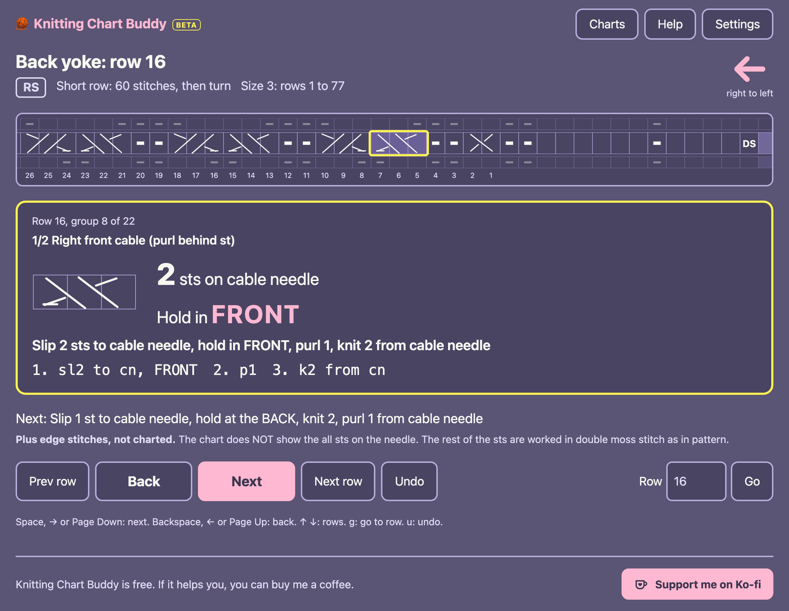

# Knitting Chart Buddy

[](https://github.com/imcarvalho/knitting-chart-buddy/actions/workflows/deploy.yml)

Are you like me and keep getting lost in knitting charts / can't see the tiny graphs? 

HERE'S AN APP FOR YOU! 



**Use it here: https://imcarvalho.github.io/knitting-chart-buddy/** (free, nothing to install).

It reads the knitting chart from your pattern PDF and shows you one group of stitches at a time, in
big letters, with the chart row right above it. For cables, it tells you how many stitches go on the
cable needle and whether to hold them in front or at the back. It remembers where you stopped.

## How to use it

You need: the pattern PDF from the designer, and a phone, tablet or computer with a web browser.

### 1. Make a PDF with just the chart page

The app reads one page with one chart on it. Most patterns have many pages, so save the chart page
on its own:

- **On a Mac:** open the pattern in Preview, choose File, Print, type the chart's page number in
  "Pages", then click the PDF button at the bottom and choose Save as PDF.
- **On Windows:** open the pattern in your browser or PDF reader, choose Print, pick "Microsoft Print
  to PDF" as the printer, type the chart's page number, and print.
- **On a phone:** it's easier to do this step on a computer, then send the new PDF to your phone.

**It has to be the designer's PDF, not a scan or a photo.** The app reads the lines and numbers the
designer drew. A scan, a photo or a screenshot is just a picture, and it won't work. Quick test: zoom
right in on the chart. If the lines stay sharp and you can select the row numbers like text, you're
good.

### 2. Open it in the app

Go to https://imcarvalho.github.io/knitting-chart-buddy/, then drop the PDF on the box or press
**Choose a file**. Give the chart a name (like "Back yoke"), pick your size, and you're at row 1.

Your PDF is read on your own device. It is never uploaded anywhere.

### 3. Knit!

- The big card is the stitches to work now. The highlighted square in the chart above shows where
  you are.
- The arrow shows which way to read the row (right to left, or left to right).
- Below the card, "Next" tells you what comes after, so you're never surprised.
- Press **Next** when you've done a group, **Back** if you went too far, and **Undo** if you pressed
  the wrong thing. **Prev row** and **Next row** jump a whole row; type a number in **Row** and press
  **Go** to jump anywhere.

On a phone or tablet you can also tap the right half of the card for next and the left half for
back, or swipe up and down to change rows. On a computer, use the space bar for next and Backspace
for back. A Bluetooth page turner works too, so your hands can stay on the needles.

### 4. Stop whenever you like

Close the page and come back later: the chart opens on the same row and stitch, on the same device.
To switch patterns, press **Charts**. Your charts and places stay on the device and are never sent
anywhere, so they won't show up on a different phone or computer.

### Handy settings

Press **Settings** for:

- **Theme:** Fairyfloss (the pink and lavender one), Dracula, or High contrast.
- **Large text:** bigger letters everywhere.
- **Keep the screen on:** stops your phone or tablet going to sleep while you knit.

**Tip:** on a phone or tablet, use your browser's "Add to Home Screen" to keep the app one tap away.
It works offline after your first visit.

### If it doesn't work

- **"expected a single-page PDF":** the PDF has more than one page. Save just the chart page (see
  step 1).
- **"no chart grid found":** the PDF is probably a scan or a picture, not the designer's file (see
  step 1).
- **A message naming a row and column, like "page 1, row 12, column 30":** for now the app only
  knows the symbols of the Shanon Sweater by @hongttoknit. Other patterns with different symbols
  aren't supported yet.

## For developers

See [SPEC.md](SPEC.md).

- `extractor/`: Python (PyMuPDF). PDF in, chart JSON out (`schema/chart.schema.json`).
- `legend/chart-symbols.json`: symbol legend and glyph templates for the Shanon Sweater.
- `web/`: React + TypeScript + Vite PWA that steps through a chart. It reads chart PDFs itself
  (`web/src/extractor/`, a TypeScript port of the Python extractor running on pdf.js), so the
  PDF never leaves the device.

### Pattern files are not in the repository

The chart PDFs (`fixtures/`) and the chart JSON extracted from them (`web/tests/fixtures/`) are
copyrighted pattern content and are git-ignored. Put your own copies in `fixtures/`.

The sample JSON is only used by the tests. It lives under `web/tests/`, not `web/public/`, so it
never ends up in a build, and the app has no bundled sample. The extractor tests and `pnpm sample`
need the back yoke PDF. `pnpm test` and `pnpm e2e` generate the sample JSON from it when it is
missing.

### Extract a chart

```sh
cd extractor && uv sync
uv run python -m chart_buddy.cli extract ../fixtures/Shanon_Sweater_tamanho3-back.pdf \
    --legend ../legend/chart-symbols.json --id back-yoke --title "Back yoke" --size 3 -o ../out/back.json
uv run python -m chart_buddy.cli show ../out/back.json --row 2
```

### Run the app

```sh
cd web && pnpm install
pnpm dev
```

The extracted chart and the position are saved on the device (chart in IndexedDB, position in
localStorage). Extracted .json files open too.

### Styles and themes

Styles are written in TypeScript with [vanilla-extract](https://vanilla-extract.style), which turns
them into a static CSS file at build time. Each component has its own `*.css.ts` file next to it.

`web/src/styles/` holds the shared parts, in three layers:

- `palettes.ts`: colour primitives, the raw colours of each palette (fairyfloss, Dracula, high contrast).
- `themes.ts`: each theme maps the semantic tokens (`bg`, `surface`, `text`, `accent`, `front`,
  `back`, ...) onto colours from its palette, and sets its label and colour scheme.
- `tokens.css.ts`: the token contract. It turns every theme into CSS custom properties under
  `:root[data-theme='<name>']`. Components only use these tokens (`vars.color.*`), never palette
  colours.

`global.css.ts` has the element styles (body, buttons, focus ring) and `ui.css.ts` the shared
classes (primary button, form fields).

To add a theme:

1. Add its colours to `palettes.ts`.
2. Add an entry to `themes` in `themes.ts`, with a value for every token. TypeScript fails the build
   if one is missing.

The settings menu lists every theme in `themes`, and the app sets `<html data-theme>` to the one
chosen. Keep text at 4.5:1 contrast or more, and chart lines and controls at 3:1 or more.

### Deploy (GitHub Pages)

`.github/workflows/deploy.yml` builds `web/` and publishes it on every push to `main` (or by hand
from the Actions tab). The app is then at `https://<user>.github.io/knitting-chart-buddy/`.

One-time setup: in the repository on GitHub, go to Settings, Pages, and set Source to
"GitHub Actions".

How it works:

- Pages serves the app from `/<repo>/`, so the workflow sets `BASE_PATH=/<repo>/` for the build.
  `vite.config.ts` uses it as Vite's `base` and as the PWA's `start_url` and `scope`. Without
  `BASE_PATH` the base is `/`, which is what `pnpm dev`, `pnpm preview` and the e2e test use.
- `pnpm build` type-checks only the shipped code (`tsconfig.app.json`), because the tests need the
  git-ignored sample and a clean checkout does not have it. `pnpm typecheck` still checks
  everything locally.
- The workflow fails if a PDF or a sample chart ends up in `dist/`.
- The app keeps working offline after the first visit. After a deploy it updates itself on the
  next load.

To try the Pages build locally:

```sh
cd web && BASE_PATH=/knitting-chart-buddy/ pnpm build && pnpm preview --base /knitting-chart-buddy/
```

### Keeping the two extractors in step

The Python extractor (`extractor/`) is the reference. The TypeScript port in `web/src/extractor/`
mirrors it file by file (`pdf_grid.py` / `grid.ts` + `page.ts`, `symbols.py` / `symbols.ts`,
`chart.py` / `chart.ts`). `web/tests/unit/extractor.test.ts` checks that both produce identical
JSON for the fixture, so change both together.

### Tests

```sh
cd extractor && uv run pytest
cd web && pnpm typecheck && pnpm test && pnpm e2e
```
